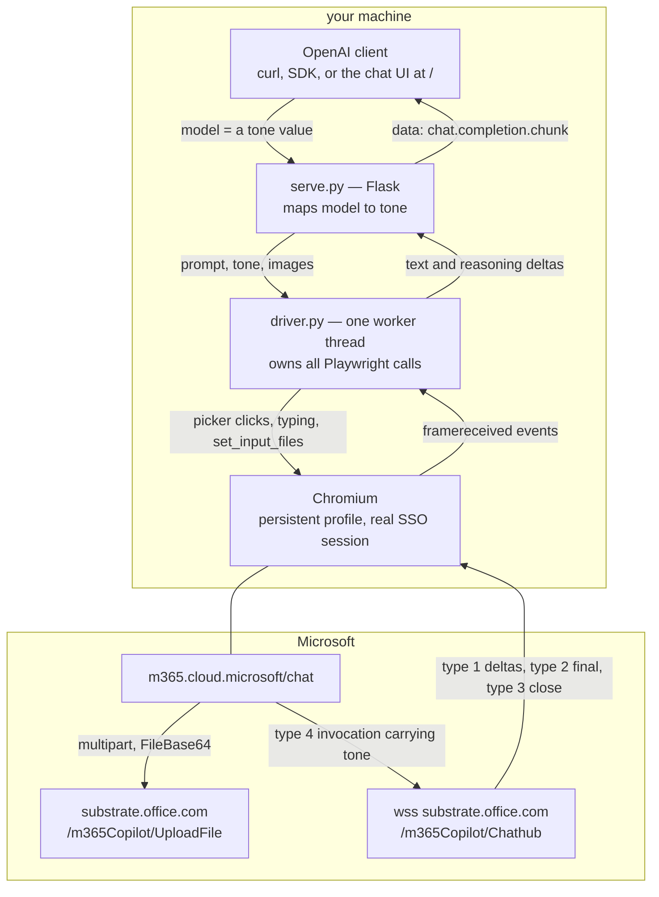
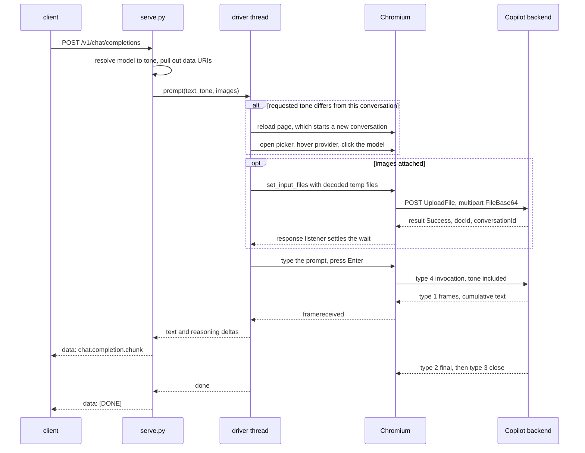

# i want my model picker back

An OpenAI-compatible endpoint for Microsoft 365 Copilot in which `model` actually
does something.

Copilot's GUI has a model picker. Microsoft's official Copilot Chat API has no
model parameter. Microsoft is also deleting the picker. This works out what the
web client sends when you touch that dropdown, and puts an API in front of it.

### ⬇ [Download the Windows installer](https://github.com/aweussom/i-want-my-model-picker-back/releases/latest)

Unsigned, so SmartScreen will object — build it yourself from `electron/` if that
bothers you, which is a reasonable position for a tool that drives your Microsoft
session. Everything below is how it works and how it was found.

> A light-hearted write-up of how this was worked out — including the part where I
> confidently published the wrong answer — is coming to dev.to.
> *(Link goes here once it is live.)*

**What this does not fix.** Nothing here removes the business harness. The chat
payload carries 34 `optionsSets` flags and 31 permitted message types, and GPT 5.6
arrives at your question already wearing enterprise search grounding, a sanitiser,
citation rewriting, a plugin dispatcher, and a flag named
`cdxgrounding_api_v2_rich_web_answers_reference_bottom_force`. All of that stays.
The only thing that changes is **which** model gets thrown overboard wearing it.

---

## Getting started

```powershell
git clone https://github.com/aweussom/i-want-my-model-picker-back
cd i-want-my-model-picker-back

python -m venv .venv
.\.venv\Scripts\python.exe -m pip install playwright flask
.\.venv\Scripts\python.exe -m playwright install chromium
```

**1. Sign in once.** A real Chromium opens; log into Copilot. The profile
persists, so you only do this once per account.

```powershell
.\.venv\Scripts\python.exe capture.py --label signin --seconds 300
```

Use a separate profile per account — keep work and personal apart:

```powershell
.\.venv\Scripts\python.exe capture.py --label signin --profile .profile-personal --seconds 300
```

**2. Run it as an app.** `app.bat` starts the server, waits for it to actually be
ready, and opens the UI in a Chromium `--app` window — no address bar, no tabs,
its own taskbar entry. Closing the window shuts the server down.

```powershell
.\app.bat                              # or double-click it
.\app.bat -KeepServer                  # leave the server up afterwards
.\app.bat -ProfileDir .profile-personal
```

No new dependencies: it uses whichever Chromium-family browser you already have,
falling back Chrome → Edge → Playwright's own. Expect **two** windows — the app,
and the Playwright browser holding the Copilot session. That is inherent to the
design; the second one is where the work happens.

Or start the server by hand:

```powershell
.\.venv\Scripts\python.exe serve.py --port 8790
```

**3. Use it.** Chat UI at <http://127.0.0.1:8790/>, or talk OpenAI to it:

```bash
curl http://127.0.0.1:8790/v1/chat/completions \
  -H "Content-Type: application/json" \
  -d '{"model":"Gpt_5_6_Reasoning","stream":true,
       "messages":[{"role":"user","content":"hi"}]}'
```

`GET /v1/models` lists the five valid values. Images work via the standard
`image_url` part with a base64 `data:` URI. Progress messages come back as
`reasoning_content`, so a client can fold "Getting things ready…" into a thinking
block instead of showing it as the answer.

A browser window stays visible while this runs. That is deliberate: it is the
thing holding your session, and `--headless` only works once the profile has one.

### Reproducing the finding

Two runs differing only in the picker, then diff them:

```powershell
.\.venv\Scripts\python.exe run_probe.py --label send-auto  --tone "Auto" --prompt "Reply with exactly the word OK and nothing else."
.\.venv\Scripts\python.exe run_probe.py --label send-think --tone "GPT 5.6 Think deeper" --prompt "Reply with exactly the word OK and nothing else."
.\.venv\Scripts\python.exe diff_frames.py captures\send-auto.jsonl captures\send-think.jsonl
```

---

## Architecture

Playwright owns the browser but not the conversation. We type into the real
composer, then read the reply off the WebSocket frames the page already receives
rather than scraping rendered HTML. The DOM can tell you text stopped growing; the
wire tells you the turn is *finished*, which is a different and much more useful
fact.



One browser means one conversation at a time; turns serialise behind a lock.
Because `tone` is per-conversation, changing `model` between requests starts a new
Copilot conversation and the previous context is gone.

### A single turn



---

## The finding

Model selection travels in a field named **`tone`**, at the top level of the chat
invocation, a sibling of `message` rather than a property of it.

`tone` is inherited from Bing Chat, where it held *Creative* / *Balanced* /
*Precise*. Microsoft kept the field and repurposed it to carry model and reasoning
mode. The default value is called `Magic`.

Two runs, same prompt, picker moved from Auto to GPT 5.6 Think deeper:

```
=== wire diff (send-auto -> send-think) ===
  ~ arguments[0].tone: "Magic" -> "Gpt_5_6_Reasoning"
```

One field. The 34 `optionsSets` flags, the 31 `allowedMessageTypes`, the whole
`message` object — byte-identical.

### The full enum

From the client's own `clientPreferences.modelSelectorMetadata`, so this is every
value the app ships rather than only those seen in traffic:

| `tone` value | Menu label | Section |
|---|---|---|
| `Magic` | Auto — "Decides how long to think" | 1 (default) |
| `Chat` | Quick response — "Answers right away" | 1 |
| `Reasoning` | Think deeper — "Think longer for better answers" | 1 |
| `Gpt_5_6_Reasoning` | GPT 5.6 Think deeper (short: "GPT 5.6 Think") | 2 |
| `Gpt_5_5_Chat` | GPT 5.5 Quick response | 2 |

Section 1 holds the generic modes that survived the 7 July 2026 change; section 2
holds the residual named models. Chat history on this tenant still contains
`Gpt_5_4_Reasoning` threads even though 5.4 is no longer offered in the menu — the
values outlive the buttons.

`tone` is **per conversation**, not per profile. A new chat resets to `Magic`
regardless of what was selected elsewhere.

---

## Wrong turns

Everything that cost real time was our own instrumentation quietly failing. This
is the transferable part, because **a silent observer failure looks exactly like
"the system doesn't do that."**

The route from "there's a dropdown" to a one-line diff was not straight:

```mermaid
flowchart TD
    saw["Spot GPT 5.6 Think in the old-design picker"] --> official{"Use the official<br/>Copilot Chat API?"}
    official -->|"no model parameter at all,<br/>and needs an add-on licence"| dead1["Dead end.<br/>Even paying would not help"]

    dead1 --> rec["Record the page's WebSocket frames"]
    rec --> trouter["Only a Trouter socket appears.<br/>Auth and presence, zero chat content"]
    trouter --> wrong1["WRONG: the public writeups<br/>describe a dead surface"]

    trouter --> leak["Raw socket.io frames bypassed redaction<br/>and wrote a live bearer token to disk"]
    leak --> fix1["Redact at the write boundary,<br/>so no parse path can skip it"]

    wrong1 --> http["Chat must be HTTP then.<br/>Add POST capture and CDP SSE"]
    http --> nosse["Zero SSE events,<br/>while the page visibly streams"]
    nosse --> fix2["eventSourceMessageReceived only fires<br/>for real EventSource.<br/>Wrap fetch in-page instead"]

    fix2 --> tap["In-page tap sees bodies,<br/>but every url field is empty"]
    tap --> fix3["fetch takes string, URL or Request.<br/>Resolve relative URLs,<br/>read Request.clone"]

    fix3 --> found["tone found in history and<br/>clientPreferences. Full enum recovered"]
    found --> nosend["But still no send captured:<br/>nobody had pressed Enter"]

    nosend --> auto["Automate the send"]
    auto --> nocomposer["No composer found"]
    nocomposer --> fix4["It is a span with role=textbox,<br/>not a div or textarea.<br/>Ask the DOM, stop guessing"]
    fix4 --> nomodel["Picker opens, but the model is not listed"]
    nomodel --> fix5["Named models sit behind a submenu<br/>that opens on hover.<br/>Clicking the parent collapses it"]

    fix5 --> sent["Prompt sent. The Chathub socket appears"]
    sent --> correct["CORRECTION: the writeups were right.<br/>The socket opens lazily on first send"]
    correct --> diff["One-line diff:<br/>tone Magic to Gpt_5_6_Reasoning"]

    diff --> build["Build the API and driver"]
    build --> timeout["Browser answers correctly on screen.<br/>API returns no completion frame"]
    timeout --> fix6["Playwright dispatches events only while<br/>the thread is inside a Playwright call.<br/>queue.get starved every handler"]

    fix6 --> wrong2["WRONG: images cannot work"]
    wrong2 --> probe["Watch an actual upload"]
    probe --> images["UploadFile takes base64 in multipart,<br/>bound to the conversation server-side"]

    classDef bad fill:#4a1418,stroke:#c0392b,color:#f5d5d5
    classDef wrong fill:#4a3510,stroke:#d68910,color:#f7e3c0
    classDef good fill:#12401f,stroke:#27ae60,color:#cdeed6
    classDef win fill:#123a4a,stroke:#2980b9,color:#cde5f2
    class dead1,leak,nosse,tap,nocomposer,nomodel,timeout,nosend bad
    class wrong1,wrong2 wrong
    class fix1,fix2,fix3,fix4,fix5,fix6,correct good
    class found,sent,diff,images win
```



Four of those are bugs in the observer, not the target. Two are confident wrong
conclusions. One leaked a credential. The details follow.

### Publishing a confident, wrong conclusion

Every public writeup describes a SignalR WebSocket at
`substrate.office.com/.../Chathub`. We loaded the page, recorded every frame, and
found no such thing — only a **Trouter** socket
(`go-eu.trouter.teams.microsoft.com`, socket.io framing, tagged `ua=BizChat`)
carrying auth and presence chatter and zero chat content. So we wrote a confident
paragraph declaring the published descriptions obsolete.

Wrong. **The Chathub socket opens lazily, on the first message send.** Every
capture analysed was a page load where nobody typed anything. "No Chathub" was an
artefact of never having pressed Enter. The published descriptions are
substantially correct; what they miss is `tone`.

### Redaction that could be bypassed

The recorder scrubbed credentials only on JSON it could parse. Trouter's socket.io
frames (`5:::{…}`) failed `json.loads`, fell through to a raw branch, and wrote a
live `Authorization: Bearer eyJ…` to disk in cleartext. Redaction now runs on
every line immediately before it is written, so no parse path can skip it.
Sanitise at the boundary, not per branch.

### `fetch()` takes three argument shapes

A string, a `URL`, or a `Request`. We handled strings, so every record had an empty
`url` and no endpoint could be identified. Bodies on a `Request` live on the
object, not in `init.body`, and need `request.clone().text()`. Later the same bug
recurred for uploads: only *string* bodies were captured, so a multipart
`FormData` upload showed up as a POST with no body at all.

### CDP cannot see fetch-based streaming

`Network.eventSourceMessageReceived` fires only for the real `EventSource` API. An
app streaming `text/event-stream` through `fetch` and a `ReadableStream` is
invisible to it — zero SSE events while the page visibly streams text. Wrapping
`fetch` in-page is the only reliable way; read `response.clone()` so the app's own
stream is untouched.

### Playwright's sync API needs the thread inside it

Playwright dispatches event callbacks **only while the owning thread is inside a
Playwright call.** The driver's command loop blocked on `queue.get()` — ordinary
Python — which starved every `framereceived` handler. The browser answered
correctly on screen while the API returned `no completion frame before timeout`.
The loop now polls the queue and idles inside `wait_for_timeout`.

### Two selector lessons

The composer is a `<span>` with `role="textbox"`, not a `div` or a `textarea`. And
the named models sit behind a provider submenu that opens on **hover** — clicking
the parent collapses it. Both were solved by `probe_dom.py`, which asks the page
what it contains instead of guessing. Guessing cost more than asking would have.

---

## Reference

### Transport

```
wss://substrate.office.com/m365Copilot/Chathub/{userObjectId}@{tenantId}
    ?chatsessionid=…&XRoutingParameterSessionKey=…&ConversationId=…
```

SignalR over WebSocket. The client sends a `type: 4` invocation to
`target: "chat"`; the server streams the reply and closes the invocation.

```json
{"type": 4, "target": "chat", "invocationId": "0", "arguments": [{
  "tone": "Gpt_5_6_Reasoning",
  "source": "officeweb",
  "streamingMode": "ConciseWithPadding",
  "message": {
    "author": "user", "inputMethod": "Keyboard", "messageType": "Chat",
    "text": "Reply with exactly the word OK and nothing else.",
    "locale": "no", "locationInfo": {"timeZone": "Europe/Oslo"}
  },
  "optionsSets": ["cwc_flux_v3", "flux_v3_references", "…32 more"],
  "allowedMessageTypes": ["Chat", "Suggestion", "Progress", "…28 more"]
}]}
```

Replies arrive as `type: 1` frames whose text is **cumulative**, not incremental,
so the driver tracks the longest prefix per message id and yields only the tail.
Bot messages with `messageType: "Progress"` are chatter; the real answer has no
`messageType` at all and carries `contentOrigin: "DeepLeo"`.

### Image attachments

Images do not travel in the chat frame. They go to a separate endpoint first:

```
POST https://substrate.office.com/m365Copilot/UploadFile
Content-Type: multipart/form-data

scenario       = UploadImage
conversationId = <guid>
FileBase64     = data:image/png;base64,iVBORw0KGgoAAAANSUhEUg…
optionsSets    = cwcgptvsan
optionsSets    = flux_v3_gptv_enable_upload_multi_image_in_turn_wo_ch
optionsSets    = gptvnorm2048
```

```json
{"fileName": "0588acdec7.png", "fileSize": 248736, "fileType": ".png",
 "docId": "0-neu-d9-…", "fileSanitizer": "ImageSanitizerBingAI",
 "conversationId": "eb6ec1d7-…",
 "result": {"value": "Success", "message": "Success"}}
```

The interesting part is what the following `type: 4` frame contains: no `docId`,
no attachment array, an empty `message.adaptiveCards`. The upload carries
`conversationId`, so the image is bound to the **conversation server-side** and
the prompt stays an ordinary prompt.

`driver.py` does not hand-roll that POST. It writes decoded bytes to a temp file
and hands them to Copilot's own `input[type=file]`, so the app builds the
multipart body, supplies the `conversationId` and the gptv `optionsSets`, and
carries its own auth — much less to keep in step when Microsoft changes things.
A `page.on("response")` listener waits for the real `result.value` rather than
sleeping and hoping.

Two things are refused loudly rather than silently: remote `http(s)` image URLs
are skipped rather than fetched, so the proxy makes no outbound requests on a
caller's behalf; and anything under 1 KB is skipped locally, because a 77-byte
8×8 PNG comes back `{"fileSanitizer": "None", "result": {"value":
"InvalidRequest"}}` with a courteous apology in Norwegian.

### Tools

| Script | Job |
|---|---|
| `serve.py` | Flask: chat UI at `/`, plus `/health`, `/v1/models`, `/v1/cancel`, `/v1/chat/completions`. |
| `driver.py` | Resident browser on one thread; picker, typing, uploads, frame reading. |
| `capture.py` | Passive recorder. You drive; it records frames, POST bodies and streams. |
| `tap.js` | Injected before page scripts; wraps `fetch`, `EventSource`, `XMLHttpRequest`. |
| `run_probe.py` | Automated: select a model, send a prompt, capture the turn. |
| `diff_frames.py` | Diffs two captures' chat invocations, filtering GUID noise. |
| `inspect_capture.py` | Summarises a capture: endpoints, streams, model-selector candidates. |
| `probe_dom.py` | Dumps the page's real inputs and buttons, so selectors rest on fact. |
| `probe_image.py` | Attaches a file and records the upload path. |
| `find_tones.py` | Scrapes the tone enum from the app's own JavaScript bundles. |

Known gaps are in [TODO.md](TODO.md).

---

## Security

`.gitignore` excludes `.profile/` and `captures/`, and both matter.

- **`.profile/`** holds live session cookies for whichever Microsoft account you
  signed into. Committing it is equivalent to publishing your credentials.
- **`captures/`** holds raw traffic. Bearer tokens and JWTs are redacted
  automatically, but frames still contain your prompts, the replies, your chat
  titles, your tenant ID and your user object ID. Read a capture before pasting
  any of it in public.

Signed into a **work or school** account, everything here runs against your
employer's tenant under your own identity, with tenant audit logging and whatever
your acceptable-use policy says about non-browser clients. A personal Microsoft
account is the safer thing to demo and publish against.

## Credit

The SSE chunk encoder in `serve.py`, the confine-Playwright-to-one-thread pattern
in `driver.py`, and the entire web UI come from
**[agentry](https://github.com/aweussom/agentry)** — a local proxy that points
your OpenAI SDK at the coding-agent subscription you already pay for. It wraps a
CLI (GitHub Copilot, OpenAI Codex, or Claude Code), strips its tool surface, and
serves the bare model at `/v1/chat/completions`. Write-up:
[dev.to](https://dev.to/tommy_leonhardsen_81d1f4e/i-built-an-openai-compatible-proxy-for-github-copilot-because-search-was-too-stupid-to-understand-31de).

This repo is the disreputable cousin. Every agentry backend speaks a *documented*
protocol on purpose, and its
[`TODONT.md`](https://github.com/aweussom/agentry/blob/main/TODONT.md) argues
against reverse-engineering chat backends: maintenance treadmill, terms of
service, account-ban risk. I wrote it. I agree with it.

## License

MIT
