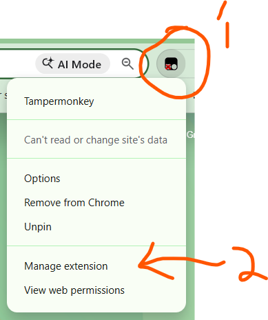
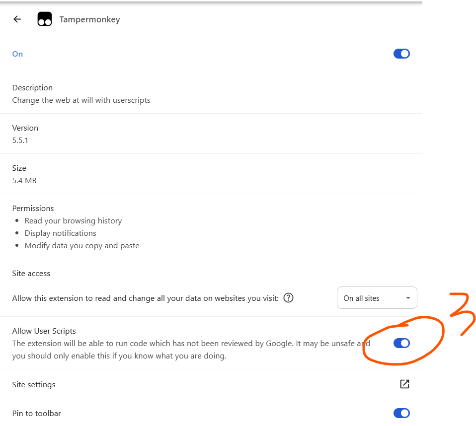

# i want my model picker back

A userscript that makes Microsoft 365 Copilot send every message to the best GPT model your account has, whatever the model menu says.

## Install

1. Install [Tampermonkey](https://www.tampermonkey.net/) or Violentmonkey in Chrome, Edge or Firefox.
2. Let it run scripts. Chrome and Edge run no userscript until this switch is on, and Tampermonkey stays quiet about it. Right-click the Tampermonkey icon in the toolbar and pick Manage extension:

   

   On the page that opens, turn on Allow User Scripts:

   

   The screenshots are Chrome; Edge has the same switch. Firefox probably has something like it too. I have not checked, so if the script does nothing there, look in the extension's permissions.
3. Open the script's raw file: <https://raw.githubusercontent.com/aweussom/i-want-my-model-picker-back/main/userscript/model-picker.user.js>. Tampermonkey shows an install page. Click Install.
4. Reload Copilot (`m365.cloud.microsoft` or `copilot.cloud.microsoft`).

That is all. The script carries its own update URL, so Tampermonkey fetches new versions from the same place by itself. When Copilot changes and the script needs a fix, it reaches you without you doing anything.

It needs a work or school account. A free consumer account only gets Auto, Quick response and Think deeper, so there is nothing better to pick. Details in [docs/FINDINGS.md](docs/FINDINGS.md#personal-and-free-accounts).

## What you see

A small badge in the corner names the model it forces. It is click-through, so it never covers anything. If the badge is red, the script could not read Microsoft's model menu and is rewriting nothing; Copilot then runs on whatever its own menu says.

Microsoft's menu keeps showing its own label, Auto for example, because the script never touches it. Reopen a chat and the menu shows the model that actually answered.

The browser console logs what it does, prefixed `[model-picker-overlay]`. No `loaded` line means the script was not injected. Loaded but never logging a send means Copilot changed its transport and the script is doing nothing.

To turn it off without uninstalling, run `__mpo.setTone("")` in the console. `__mpo.setTone("best")` turns it back on.

## What it does

Copilot's GUI has a model picker. Microsoft's official Copilot Chat API has no model parameter. I worked out what the web client sends when you touch that menu: one field, `tone`, in the chat message on the Chathub WebSocket. The script wraps `WebSocket.prototype.send` and sets that field. Everything else goes out byte for byte.

It picks the bottom entry of Microsoft's GPT submenu, today `Gpt_62_Sol_Reasoning` ("GPT-6.2 Sol"). The bottom one has been the expensive model from 5.6 through 6.2, while the names changed shape three times. So the script reads the menu out of the page and takes its position, not its name.

Last checked 25 November 2026 on a work tenant, version 20261125-225004: a new chat on Auto went out as `Gpt_62_Sol_Reasoning`, and the thread reopened with the menu showing "GPT-6.2 Sol". Older checks are in [docs/FINDINGS.md](docs/FINDINGS.md).

It does not remove the business harness. The model still arrives with enterprise search grounding, a sanitiser, citation rewriting and a few dozen feature flags. Only the model underneath changes.

## The API, for scripts and aider

An OpenAI-compatible `/v1/chat/completions` on `127.0.0.1:8791`. Node and Playwright drive a real, signed-in browser with the userscript injected, and the `model` you ask for goes into `tone`.

```powershell
git clone https://github.com/aweussom/i-want-my-model-picker-back
cd i-want-my-model-picker-back\api
npm install
npm run signin      # once per profile; a browser opens, log in
npm run serve
```

`GET /v1/models` lists what your account's menu offers. A model that is not on it gets a 400, not a quiet swap. Setup, images and profiles: [api/README.md](api/README.md). Running aider on it: [RUNBOOK.md](RUNBOOK.md).

## Security

- `.profile/` holds live session cookies for the account you signed into. Committing it publishes your credentials. `.gitignore` excludes it.
- `captures/` from the research tools holds raw traffic: prompts, replies, chat titles, tenant ID. Tokens are redacted, the rest is not. Also excluded.
- On a work or school account all of this runs against your employer's tenant under your own identity, with its audit logging and whatever its acceptable-use policy says about non-browser clients. The userscript is just your own browser sending a different value in one field. The API is a robot driving your account.

## Background

[docs/FINDINGS.md](docs/FINDINGS.md) has how the field was found, the full list of values, how the API is built, the wrong turns, and the wire details. [TODONT.md](TODONT.md) has what was tried and did not work.

A write-up of how I worked this out, including where I confidently published the wrong answer, is coming to dev.to.

## Credit

The SSE chunk encoder, the one-thread Playwright pattern in the archived Python driver, and the web UI come from [agentry](https://github.com/aweussom/agentry), a local proxy that points your OpenAI SDK at the coding-agent subscription you already pay for ([dev.to](https://dev.to/tommy_leonhardsen_81d1f4e/i-built-an-openai-compatible-proxy-for-github-copilot-because-search-was-too-stupid-to-understand-31de)).

This repo is its disreputable cousin. agentry's [TODONT.md](https://github.com/aweussom/agentry/blob/main/TODONT.md) argues against reverse-engineering chat backends: maintenance treadmill, terms of service, ban risk. I wrote it. I agree with it.

## License

MIT
