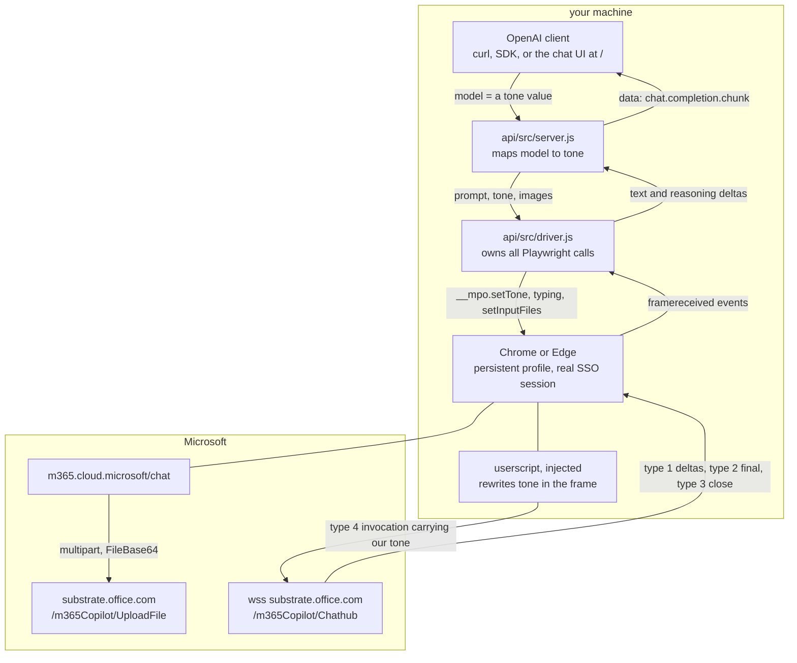
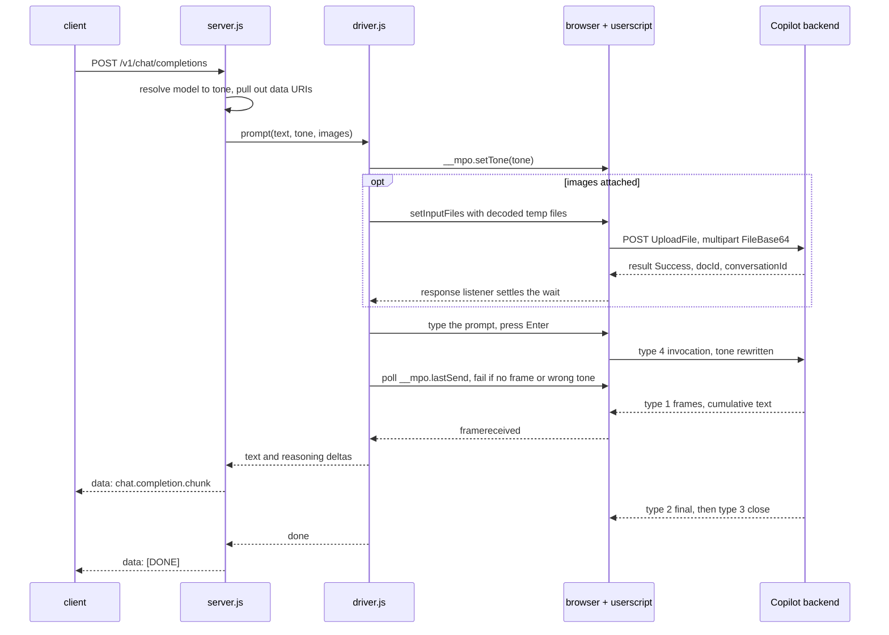

# i want my model picker back

Microsoft 365 Copilot always gets the best model, whatever Microsoft's picker says.

Copilot's GUI has a model picker. Microsoft's official Copilot Chat API has no
model parameter. I worked out what the web client sends when you touch that
dropdown. It is one field. This repo sets it for you, two ways:

1. A browser userscript. Install it and forget it. Start here.
2. An OpenAI-compatible API, for scripts and SDK clients. Same userscript under the hood.

Earlier versions of this file said Microsoft was deleting the picker. On a work
tenant it is still there: re-checked on 15 September 2026, and again on 4 November,
when the entries had been renamed "GPT-5.6 Sol". What varies is the account. A free
consumer account gets the three generic modes and no GPT submenu at all. See
[Is it still there?](#is-it-still-there--re-checked-15-september-2026) for how that
was measured.

> A light-hearted write-up of how I worked this out, including where I confidently published the wrong answer, is coming to dev.to. Link goes here once it is live.

**What this does not fix.** Nothing here removes the business harness. The chat payload carries 36 `optionsSets` flags and 30 permitted message types (15 September 2026; the counts drift), and GPT 5.6 arrives at your question already wearing enterprise search grounding, a sanitiser, citation rewriting, a plugin dispatcher, and a flag named `cdxgrounding_api_v2_rich_web_answers_reference_bottom_force`. All of that stays. The only thing that changes is **which** model gets thrown overboard wearing it.

## The userscript

[`userscript/model-picker.user.js`](userscript/model-picker.user.js). Install with Tampermonkey or Violentmonkey: create a new script, paste the file in, save, reload Copilot. It matches `m365.cloud.microsoft` and `copilot.cloud.microsoft`.

Nothing to set. Every message goes out on the best reasoning model the script knows, today `Gpt_5_6_Reasoning` ("GPT-5.6 Sol Think deeper" in Microsoft's menu). A small badge in the corner says what it is forcing. It is click-through, so it never covers anything.

If Microsoft ships something newer and you pick it once in their menu, the script sees a higher `Gpt_<major>_<minor>_Reasoning` go out, adopts it as the new best, and remembers it. No edit needed.

How it works: it wraps `WebSocket.prototype.send`, finds the chat invocation on the Chathub socket, and replaces one field, `arguments[0].tone`. Everything else goes out byte for byte. Microsoft's menu keeps showing its own label, because the script never touches it.

From the browser console, `__mpo.setTone("")` turns the override off and `__mpo.setTone("best")` turns it back on. With it off, the script still reports which `tone` Microsoft's picker sent. That is how I found the new values without guessing.

What I have checked, on 4 November 2026, on a work tenant:

- The rewrite goes out: the console logs `Magic -> Gpt_5_6_Reasoning` on send.
- The server keeps it: a chat sent with Microsoft's menu on Auto and the script on `Gpt_5_6_Reasoning` reopens with the menu showing "GPT 5.6 Think". The app can only have got that value from the rewritten frame.
- It is the same request the client builds: on 15 September a force-injected turn and a picker-selected one diffed identical, and a bogus tone was refused. See [Is it still there?](#is-it-still-there--re-checked-15-september-2026).
- It also works mid-conversation. A thread whose first message went out as `Magic` got one more message rewritten to `Gpt_5_6_Reasoning`. After switching to another chat and back, the menu showed "GPT 5.6 Sol Think" for it. The menu does not update live; it reads the stored value when the thread loads.

The console says what it is doing, prefixed `[model-picker-overlay]`. If there is no `loaded` line, the script was not injected into the page. If it loads but never logs a send, Copilot has changed its transport and the script is doing nothing.

## The API

For when you need `/v1/chat/completions`. Node and Playwright drive a real, signed-in browser and inject the userscript into it. The model you ask for goes straight into `tone`. Microsoft's menu is never clicked, so a menu redesign does not break it.

```powershell
git clone https://github.com/aweussom/i-want-my-model-picker-back
cd i-want-my-model-picker-back\api
npm install

npm run signin      # once per profile; a browser opens, log in
npm run serve       # http://127.0.0.1:8791
```

```bash
curl http://127.0.0.1:8791/v1/chat/completions \
  -H "Content-Type: application/json" \
  -d '{"model":"Gpt_5_6_Reasoning","stream":true,
       "messages":[{"role":"user","content":"hi"}]}'
```

Leave out `model` and you get the newest GPT reasoning tone. `GET /v1/models` lists the known values. Images work via the standard `image_url` part with a base64 `data:` URI. Progress messages come back as `reasoning_content`, so a client can fold "Getting things ready…" into a thinking block.

There is a minimal chat UI at `/` for poking at it. The rest, including `COPILOT_PROFILE` for keeping work and personal accounts apart, is in [`api/README.md`](api/README.md).

There used to be a Windows installer and a Python version. Both clicked Microsoft's menu, and the "Sol" rename in November 2026 broke them. The installer is gone; the Python API is in [`archive/python-api`](archive/python-api).

### Reproducing the finding

The research tools are Python and still work. Two runs differing only in the picker, then diff them:

```powershell
python -m venv .venv
.\.venv\Scripts\python.exe -m pip install playwright
.\.venv\Scripts\python.exe capture.py --label signin --seconds 300
.\.venv\Scripts\python.exe run_probe.py --label send-auto  --tone "Auto" --prompt "Reply with exactly the word OK and nothing else."
.\.venv\Scripts\python.exe run_probe.py --label send-think --tone "GPT-5.6 Sol Think deeper" --prompt "Reply with exactly the word OK and nothing else."
.\.venv\Scripts\python.exe diff_frames.py captures\send-auto.jsonl captures\send-think.jsonl
```

`run_probe.py` selects by menu label, so it needs the label Microsoft shows today. I have not rerun it since the Sol rename.

## Architecture

Playwright owns the browser but not the conversation. The driver types into the real composer, then reads the reply off the WebSocket frames the page already receives. It does not scrape rendered HTML. The DOM can tell you text stopped growing; the wire tells you the turn is finished, which is more useful.



One browser means one conversation at a time; turns serialise behind a lock. Changing `model` between requests keeps the conversation, because the server stores the latest tone per message.

### A single turn



---

## The finding

Model selection travels in a field named **`tone`**, at the top level of the chat
invocation, a sibling of `message` rather than a property of it.

`tone` is inherited from Bing Chat, where it held *Creative* / *Balanced* /
*Precise*. Microsoft kept the field and repurposed it to carry model and reasoning
mode. The default value is called `Magic`.

Two runs, same prompt, picker moved from Auto to GPT 5.6 Think deeper:

```
=== wire diff (send-auto -> send-think) ===
  ~ arguments[0].tone: "Magic" -> "Gpt_5_6_Reasoning"
```

One field. Every `optionsSets` flag, every `allowedMessageType`, the whole
`message` object — byte-identical. (The counts drift: 34 and 31 that day, 36 and
30 on 15 September 2026. The shape of the result does not.)

### The full enum

From the client's own `clientPreferences.modelSelectorMetadata`, so this is every
value the app ships rather than only those seen in traffic:

| `tone` value | Menu label | Section |
|---|---|---|
| `Magic` | Auto — "Decides how long to think" | 1 (default) |
| `Chat` | Quick response — "Answers right away" | 1 |
| `Reasoning` | Think deeper — "Think longer for better answers" | 1 |
| `Gpt_5_6_Reasoning` | GPT 5.6 Think deeper (short: "GPT 5.6 Think") | 2 |
| `Gpt_5_6_Chat` | GPT 5.6 Quick response (short: "GPT 5.6 Quick") | 2 |

That was August 2026. On 4 November 2026 the menu read differently, and I took the
values off the wire with the userscript set to Off:

| `tone` value | Menu label, November 2026 |
|---|---|
| `Gpt_5_6_Reasoning` | GPT-5.6 Sol Think deeper (short: "GPT 5.6 Sol Think") |
| `Gpt_5_6_Chat` | GPT-5.6 Sol Quick response |
| `Gpt_5_5_Chat` | gone from the menu, not tested since |

So "Sol" is a new label on an old value, and `Gpt_5_6_Chat` is new.

Section 1 holds the generic modes that survived the 7 July 2026 change; section 2
holds the residual named models, grouped under an `itemGroup` with `"id": "OpenAI"`
that renders as the hover submenu. Chat history on this tenant still contains
`Gpt_5_4_Reasoning` threads even though 5.4 is no longer offered in the menu — the
values outlive the buttons.

**Re-checked 15 September 2026.** `Gpt_5_5_Chat` is gone, replaced by
`Gpt_5_6_Chat`; the rest of the table is unchanged, `totalNumberOfSections` is
still 2, and `defaultModelSelectionId` is still `Magic`.

`tone` is **per conversation**, not per profile. A new chat resets to `Magic`
regardless of what was selected elsewhere. It is sent with every message, though,
and the server stores the latest one: a thread that started as `Magic` and got one
message as `Gpt_5_6_Reasoning` reopens as GPT 5.6 Sol Think.

### Is it still there? — re-checked 15 September 2026

Short answer: **yes, entirely.** On a work tenant (`licenseType=Starter`,
`scenario=OfficeWebIncludedCopilot`), as of today:

- the picker still renders, still has the GPT submenu, and still sets `tone`;
- `modelSelectorMetadata` still ships section 2, `totalNumberOfSections: 2`;
- the server still accepts `Gpt_5_6_Reasoning` — **and still rejects a value it
  does not recognise**, which is the part that makes the first three claims mean
  something.

That last point needed a tool, because the obvious test is worthless. A
successful reply proves nothing on its own: a server that had stopped reading
`tone` would return a successful reply too. So `probe_tone.py` injects
`force_tone.js`, which rewrites `tone` inside `WebSocket.prototype.send` and
leaves the 36 `optionsSets`, the 30 `allowedMessageTypes` and the whole `message`
object exactly as the real client built them. Three arms, and the third is the
experiment:

```powershell
.\.venv\Scripts\python.exe probe_tone.py --label w1-control --tone Magic                  --prompt "..." --metadata
.\.venv\Scripts\python.exe probe_tone.py --label w2-gpt56   --tone Gpt_5_6_Reasoning      --prompt "..."
.\.venv\Scripts\python.exe probe_tone.py --label w3-bogus   --tone Not_A_Real_Tone_202609 --prompt "..."
```

What came back:

| arm | `tone` sent | `type: 1` deltas | completion `result` |
|---|---|---|---|
| control | `Magic` | 7 | `{"value": "Success", "message": "OK"}` |
| named | `Gpt_5_6_Reasoning` | 7 | `{"value": "Success", "message": "OK"}` |
| bogus | `Not_A_Real_Tone_20260915` | **0** | `{"value": "NotFound", "errorCode": "ConversationNotFound"}` |

The invocations differ by exactly one field — `diff_frames.py` reports
`~ arguments[0].tone` and nothing else — and the outcomes differ. **A field being
discarded cannot produce a refusal.** So `tone` is still read, still validated,
and `Gpt_5_6_Reasoning` is still on the accept list.

One further check, worth more than it sounds: diffing a *picker-selected*
`Gpt_5_6_Reasoning` turn against a *force-injected* one reports **identical after
noise filtering**. The override is not an approximation of what the client does;
it is byte-for-byte the same request.

`probe_tone.py` refuses to report a verdict unless it can prove its own
instrument worked: `force_tone.js` reports each rewrite through the tap, and
Playwright reads the same frame a layer lower at CDP. If those two disagree, the
run is void. That check is there because this repo has been burned repeatedly by
an observer that quietly saw nothing, and **a silent observer failure looks
exactly like "the system doesn't do that."** It earned its keep on the first two
runs, which were void for a reason that had nothing to do with `tone` — see the
Turnstile entry in [TODONT.md](TODONT.md).

`--metadata` dumps `clientPreferences.modelSelectorMetadata` out of the loaded
page, which dates the other end of this: when section 2 leaves the shipped
config, the client has stopped knowing the values, not merely stopped drawing
them. It has not left yet.

---

## Wrong turns

Everything that cost real time was our own instrumentation quietly failing. This
is the transferable part, because **a silent observer failure looks exactly like
"the system doesn't do that."**

The route from "there's a dropdown" to a one-line diff was not straight:

```mermaid
flowchart TD
    saw["Spot GPT 5.6 Think in the old-design picker"] --> official{"Use the official<br/>Copilot Chat API?"}
    official -->|"no model parameter at all,<br/>and needs an add-on licence"| dead1["Dead end.<br/>Even paying would not help"]

    dead1 --> rec["Record the page's WebSocket frames"]
    rec --> trouter["Only a Trouter socket appears.<br/>Auth and presence, zero chat content"]
    trouter --> wrong1["WRONG: the public writeups<br/>describe a dead surface"]

    trouter --> leak["Raw socket.io frames bypassed redaction<br/>and wrote a live bearer token to disk"]
    leak --> fix1["Redact at the write boundary,<br/>so no parse path can skip it"]

    wrong1 --> http["Chat must be HTTP then.<br/>Add POST capture and CDP SSE"]
    http --> nosse["Zero SSE events,<br/>while the page visibly streams"]
    nosse --> fix2["eventSourceMessageReceived only fires<br/>for real EventSource.<br/>Wrap fetch in-page instead"]

    fix2 --> tap["In-page tap sees bodies,<br/>but every url field is empty"]
    tap --> fix3["fetch takes string, URL or Request.<br/>Resolve relative URLs,<br/>read Request.clone"]

    fix3 --> found["tone found in history and<br/>clientPreferences. Full enum recovered"]
    found --> nosend["But still no send captured:<br/>nobody had pressed Enter"]

    nosend --> auto["Automate the send"]
    auto --> nocomposer["No composer found"]
    nocomposer --> fix4["It is a span with role=textbox,<br/>not a div or textarea.<br/>Ask the DOM, stop guessing"]
    fix4 --> nomodel["Picker opens, but the model is not listed"]
    nomodel --> fix5["Named models sit behind a submenu<br/>that opens on hover.<br/>Clicking the parent collapses it"]

    fix5 --> sent["Prompt sent. The Chathub socket appears"]
    sent --> correct["CORRECTION: the writeups were right.<br/>The socket opens lazily on first send"]
    correct --> diff["One-line diff:<br/>tone Magic to Gpt_5_6_Reasoning"]

    diff --> build["Build the API and driver"]
    build --> timeout["Browser answers correctly on screen.<br/>API returns no completion frame"]
    timeout --> fix6["Playwright dispatches events only while<br/>the thread is inside a Playwright call.<br/>queue.get starved every handler"]

    fix6 --> wrong2["WRONG: images cannot work"]
    wrong2 --> probe["Watch an actual upload"]
    probe --> images["UploadFile takes base64 in multipart,<br/>bound to the conversation server-side"]

    classDef bad fill:#4a1418,stroke:#c0392b,color:#f5d5d5
    classDef wrong fill:#4a3510,stroke:#d68910,color:#f7e3c0
    classDef good fill:#12401f,stroke:#27ae60,color:#cdeed6
    classDef win fill:#123a4a,stroke:#2980b9,color:#cde5f2
    class dead1,leak,nosse,tap,nocomposer,nomodel,timeout,nosend bad
    class wrong1,wrong2 wrong
    class fix1,fix2,fix3,fix4,fix5,fix6,correct good
    class found,sent,diff,images win
```



Four of those are bugs in the observer, not the target. Two are confident wrong
conclusions. One leaked a credential. The details follow.

### Publishing a confident, wrong conclusion

Every public writeup describes a SignalR WebSocket at
`substrate.office.com/.../Chathub`. We loaded the page, recorded every frame, and
found no such thing — only a **Trouter** socket
(`go-eu.trouter.teams.microsoft.com`, socket.io framing, tagged `ua=BizChat`)
carrying auth and presence chatter and zero chat content. So we wrote a confident
paragraph declaring the published descriptions obsolete.

Wrong. **The Chathub socket opens lazily, on the first message send.** Every
capture analysed was a page load where nobody typed anything. "No Chathub" was an
artefact of never having pressed Enter. The published descriptions are
substantially correct; what they miss is `tone`.

### Redaction that could be bypassed

The recorder scrubbed credentials only on JSON it could parse. Trouter's socket.io
frames (`5:::{…}`) failed `json.loads`, fell through to a raw branch, and wrote a
live `Authorization: Bearer eyJ…` to disk in cleartext. Redaction now runs on
every line immediately before it is written, so no parse path can skip it.
Sanitise at the boundary, not per branch.

### `fetch()` takes three argument shapes

A string, a `URL`, or a `Request`. We handled strings, so every record had an empty
`url` and no endpoint could be identified. Bodies on a `Request` live on the
object, not in `init.body`, and need `request.clone().text()`. Later the same bug
recurred for uploads: only *string* bodies were captured, so a multipart
`FormData` upload showed up as a POST with no body at all.

### CDP cannot see fetch-based streaming

`Network.eventSourceMessageReceived` fires only for the real `EventSource` API. An
app streaming `text/event-stream` through `fetch` and a `ReadableStream` is
invisible to it — zero SSE events while the page visibly streams text. Wrapping
`fetch` in-page is the only reliable way; read `response.clone()` so the app's own
stream is untouched.

### Playwright's sync API needs the thread inside it

Playwright dispatches event callbacks **only while the owning thread is inside a
Playwright call.** The driver's command loop blocked on `queue.get()` — ordinary
Python — which starved every `framereceived` handler. The browser answered
correctly on screen while the API returned `no completion frame before timeout`.
The loop now polls the queue and idles inside `wait_for_timeout`.

### Two selector lessons

The composer is a `<span>` with `role="textbox"`, not a `div` or a `textarea`. And
the named models sit behind a provider submenu that opens on **hover** — clicking
the parent collapses it. Both were solved by `probe_dom.py`, which asks the page
what it contains instead of guessing. Guessing cost more than asking would have.

---

## Reference

### Transport

```
wss://substrate.office.com/m365Copilot/Chathub/{userObjectId}@{tenantId}
    ?chatsessionid=…&XRoutingParameterSessionKey=…&ConversationId=…
```

SignalR over WebSocket. The client sends a `type: 4` invocation to
`target: "chat"`; the server streams the reply and closes the invocation.

```json
{"type": 4, "target": "chat", "invocationId": "0", "arguments": [{
  "tone": "Gpt_5_6_Reasoning",
  "source": "officeweb",
  "streamingMode": "ConciseWithPadding",
  "message": {
    "author": "user", "inputMethod": "Keyboard", "messageType": "Chat",
    "text": "Reply with exactly the word OK and nothing else.",
    "locale": "no", "locationInfo": {"timeZone": "Europe/Oslo"}
  },
  "optionsSets": ["cwc_flux_v3", "flux_v3_references", "…34 more"],
  "allowedMessageTypes": ["Chat", "Suggestion", "Progress", "…27 more"]
}]}
```

Replies arrive as `type: 1` frames whose text is **cumulative**, not incremental,
so the driver tracks the longest prefix per message id and yields only the tail.
Bot messages with `messageType: "Progress"` are chatter; the real answer has no
`messageType` at all and carries `contentOrigin: "DeepLeo"`.

### Image attachments

Images do not travel in the chat frame. They go to a separate endpoint first:

```
POST https://substrate.office.com/m365Copilot/UploadFile
Content-Type: multipart/form-data

scenario       = UploadImage
conversationId = <guid>
FileBase64     = data:image/png;base64,iVBORw0KGgoAAAANSUhEUg…
optionsSets    = cwcgptvsan
optionsSets    = flux_v3_gptv_enable_upload_multi_image_in_turn_wo_ch
optionsSets    = gptvnorm2048
```

```json
{"fileName": "0588acdec7.png", "fileSize": 248736, "fileType": ".png",
 "docId": "0-neu-d9-…", "fileSanitizer": "ImageSanitizerBingAI",
 "conversationId": "eb6ec1d7-…",
 "result": {"value": "Success", "message": "Success"}}
```

The interesting part is what the following `type: 4` frame contains: no `docId`,
no attachment array, an empty `message.adaptiveCards`. The upload carries
`conversationId`, so the image is bound to the **conversation server-side** and
the prompt stays an ordinary prompt.

`api/src/driver.js` does not hand-roll that POST. It writes decoded bytes to a temp file
and hands them to Copilot's own `input[type=file]`, so the app builds the
multipart body, supplies the `conversationId` and the gptv `optionsSets`, and
carries its own auth — much less to keep in step when Microsoft changes things.
A `page.on("response")` listener waits for the real `result.value` rather than
sleeping and hoping.

Two things are refused loudly rather than silently: remote `http(s)` image URLs
are skipped rather than fetched, so the proxy makes no outbound requests on a
caller's behalf; and anything under 1 KB is skipped locally, because a 77-byte
8×8 PNG comes back `{"fileSanitizer": "None", "result": {"value":
"InvalidRequest"}}` with a courteous apology in Norwegian.

### Tools

| Script | Job |
|---|---|
| `userscript/model-picker.user.js` | Rewrites `tone` on the outgoing chat frame. Tampermonkey, and injected by the API. |
| `api/src/server.js` | Node `http`: test UI at `/`, plus `/health`, `/v1/models`, `/v1/cancel`, `/v1/chat/completions`. |
| `api/src/driver.js` | Resident browser; injects the userscript, types, uploads, reads frames. |
| `archive/python-api/` | The old Python API and launcher. Broken since the Sol rename. |
| `capture.py` | Passive recorder. You drive; it records frames, POST bodies and streams. |
| `tap.js` | Injected before page scripts; wraps `fetch`, `EventSource`, `XMLHttpRequest`. |
| `run_probe.py` | Automated: select a model *via the picker*, send a prompt, capture the turn. |
| `probe_tone.py` | Forces `tone` on the wire instead, so the server can be asked about a model the client no longer offers. |
| `force_tone.js` | Injected with `tap.js`; rewrites `tone` in `WebSocket.prototype.send` and reports every rewrite. |
| `diff_frames.py` | Diffs two captures' chat invocations, filtering GUID noise. |
| `inspect_capture.py` | Summarises a capture: endpoints, streams, model-selector candidates. |
| `probe_dom.py` | Dumps the page's real inputs and buttons, so selectors rest on fact. |
| `probe_image.py` | Attaches a file and records the upload path. |
| `find_tones.py` | Scrapes the tone enum from the app's own JavaScript bundles. |
| `test_probe_tone.py` | `python test_probe_tone.py` — checks the override and the verdict logic. No session needed. |

Known gaps are in [TODO.md](TODO.md). Approaches already tried and rejected, with
the measurement that rejected them, are in [TODONT.md](TODONT.md).

---

## Security

`.gitignore` excludes `.profile/` and `captures/`, and both matter.

- **`.profile/`** holds live session cookies for whichever Microsoft account you
  signed into. Committing it is equivalent to publishing your credentials.
- **`captures/`** holds raw traffic. Bearer tokens and JWTs are redacted
  automatically, but frames still contain your prompts, the replies, your chat
  titles, your tenant ID and your user object ID. Read a capture before pasting
  any of it in public.

Signed into a **work or school** account, everything here runs against your
employer's tenant under your own identity, with tenant audit logging and whatever
your acceptable-use policy says about non-browser clients.

This file has now been wrong about personal accounts in both directions, so here
is the state as of **15 September 2026**, with the evidence attached.

It first recommended a personal account. Then a free consumer account hit an
upsell wall — *"Oppgrader Microsoft 365 til å bruke Copilot Chat"* — and this
section was rewritten to say the surface was work/school only. **That is no
longer true either.** A free consumer account reaches
`m365.cloud.microsoft/chat` today, with chat history and a working picker, and
the Chathub URL says so without ambiguity:

**And then it worked.** On the next sign-in, the same free consumer account had
Copilot Chat, with no subscription and nothing bought in between. The picker
offered only the three generic modes — Auto, Quick response, Think deeper — but
the surface itself was reachable.

That left the question open: a staged rollout, an experiment bucket and a
transient failure are all consistent with two observations. What would settle it,
this file said, is `licenseType` from `GET /health` on that account.

**Settled, 15 September 2026.** The account reports:

```
licenseType=Free   scenario=OfficeWebFreeConsumerCopilot   agentHost=Bizchat.FullScreen
```

Same host, same `m365Copilot/Chathub` endpoint, same `tone` field — that
account's server-rendered history carries `tone: "Reasoning"` and `tone: "Magic"`
per conversation. So the upsell wall was not permanent, and a free account does
reach this surface.

**But reaching the surface is not the same as this working there**, and that
distinction turns out to matter more than either retraction. On that account:

```
availableTones:         ["Magic", "Chat", "Reasoning"]   <- no named models
modelSelectorMetadata:  not present in the document at all
```

The named models are not offered. What is left is Auto, Quick response and Think
deeper — which the Copilot GUI already gives you for free, without this repo, and
with `model` once again doing nothing. On top of that, every send raises a
Cloudflare Turnstile check, and an automated browser gets no invocation out at
all: the socket opens, handshakes, pings, and carries zero `type: 4` frames.

Note what that does to the test this file proposed. "Three tones in `/health`"
was written down as the *success* signal — the thing that would mean a personal
account is enough. It is the failure signal. The measurement was the right one to
ask for; the prediction attached to it was backwards.

So the position returns to where it started, now with evidence under it: **this
project does what it claims on a work or school tenant, and only there.**
Everything in the Security warning above applies, and there is no
personal-account route around it. See [TODONT.md](TODONT.md) for the
measurements, for the one question that remains open underneath, and for why the
fix is *not* to put the anti-detection flag back.

An earlier version of this section stated flatly that there was no free route.
That was one observation written up as a conclusion, and it is the second time
this project has done that — the first was declaring the substrate Chathub dead
before ever pressing Enter. Both are recorded rather than quietly edited out,
because the pattern is more useful than either claim. This round adds a third
instance of the same shape, from the other direction: the app reporting the named
models missing was read as Microsoft withdrawing them, when it was signed into
the wrong account.

The official Chat API still requires the separate Copilot **add-on** licence and
still has no model parameter. The consumer product at `copilot.microsoft.com` is
a different backend and none of the findings here have been tested against it.

## Credit

The SSE chunk encoder, the confine-Playwright-to-one-thread pattern in the
archived Python driver, and the entire web UI come from
**[agentry](https://github.com/aweussom/agentry)** — a local proxy that points
your OpenAI SDK at the coding-agent subscription you already pay for. It wraps a
CLI (GitHub Copilot, OpenAI Codex, or Claude Code), strips its tool surface, and
serves the bare model at `/v1/chat/completions`. Write-up:
[dev.to](https://dev.to/tommy_leonhardsen_81d1f4e/i-built-an-openai-compatible-proxy-for-github-copilot-because-search-was-too-stupid-to-understand-31de).

This repo is the disreputable cousin. Every agentry backend speaks a *documented*
protocol on purpose, and its
[`TODONT.md`](https://github.com/aweussom/agentry/blob/main/TODONT.md) argues
against reverse-engineering chat backends: maintenance treadmill, terms of
service, account-ban risk. I wrote it. I agree with it.

## License

MIT
